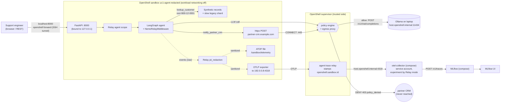

# Architecture

## Three layers of control

| Layer | Question it answers | Mechanism in this demo |
|---|---|---|
| **NeMo Relay** | What may the agent's *telemetry* contain? | `pii_redaction` sanitize guardrails on every lifecycle event, before any exporter |
| **OpenShell** | Where may the agent *process* connect, and what may it read or write? | Sandbox with networking off. Egress goes only through the supervisor, which enforces `openshell/policy.yaml` (L7 for HTTP). Landlock filesystem rules apply too. Traces leave through the supervisor's agent trace relay, not through an egress rule. |
| **MLflow** | What happened, and why? | Traces with tool status, timing, and readable (sanitized) errors, including denied egress |

Relay protects the data in the evidence. OpenShell protects the data in
execution. Neither one replaces the other:

- With Relay alone, a buggy or prompt-injected tool can still send a customer
  record to an arbitrary host. Telemetry stays clean while the data leaves.
- With OpenShell alone, the SSN still lands in the trace store, because the
  trace path to MLflow is *allowed*.

## Components and data flow



## The sandbox boundary

OpenShell splits each sandbox into an untrusted **workload**, where the
agent runs, and a trusted **supervisor**:

- **Network.** The workload container runs with networking turned off. Its
  only way out is the mediated channel to the supervisor. The supervisor
  resolves DNS, checks each connection against the policy (binary + host +
  port, and for `protocol: rest` endpoints also method + path), and opens
  approved connections. Observed with OpenShell 0.1.9 on Podman:
  - A connection to a host that no rule allows is refused at TCP level. The
    client sees `ConnectError` (`EACCES`), and the sandbox log records
    `NET:OPEN [MED] DENIED /usr/local/bin/python3.12(0) -> partner-crm.example.com:443 [reason:transparent_tcp_policy_denied]`.
  - A request to an allowed host but a disallowed method or path gets an HTTP
    `403` with a JSON body, for example
    `{"error":"policy_denied","policy":"local_llm","rule":"POST /api/pull",…}`.
  - Allowed requests are logged as well (`HTTP:POST [INFO] ALLOWED …`).
- **Binary identity.** Rules name the executable that opens the connection.
  Scripts run as their interpreter, so the policy lists
  `/usr/local/bin/python3.12`, the real path in `python:3.12-slim`. Relay's
  exporter needs no rule: it talks only to the agent trace relay, which the
  supervisor serves inside the sandbox boundary.
- **Filesystem.** Landlock restricts the workload to read-only system and
  application paths (`/usr`, `/lib`, `/etc`, `/app`, …) plus read-write
  `/sandbox` and `/tmp`. Relay writes its ATOF copy to `/sandbox/telemetry`
  and its rendered plugin config to `/tmp`.
- **Credentials.** With the optional NVIDIA provider, the workload's
  `NVIDIA_API_KEY` holds an opaque placeholder. The supervisor substitutes the
  real key only on requests to `integrate.api.nvidia.com`.
- **Inbound.** `openshell forward start 8000 <sandbox>` opens an SSH tunnel
  through the gateway to `127.0.0.1:8000` inside the sandbox. That is why
  uvicorn binds to loopback.

### Policy, rule by rule

| Rule | Endpoint | Allowed | Why |
|---|---|---|---|
| `local_llm` | `host.openshell.internal:11434` (REST, enforce) | `POST /v1/chat/completions`, `GET /v1/models` | The default LLM. Ollama's model management API (`/api/pull`, `/api/delete`, …) stays unreachable. |
| provider `uc1-nvidia-build` (optional) | `integrate.api.nvidia.com:443` | read-write | Hosted LLM, with endpoint-bound credential injection |
| *(everything else)* | | denied | Includes `partner-crm.example.com`, PyPI, MLflow, and any other internet host |

There is no MLflow rule: the agent process can't call MLflow at all, and it
holds no MLflow credentials. The collector, outside the sandbox, holds the
service account, and MLflow basic auth gives that account EDIT on the two
demo experiments only.

## Trace structure in MLflow

```
customer-lookup-request            AGENT   demo.sandbox = uc1-agent-redacted
└── customer_lookup_agent          AGENT
    ├── model → <model>            LLM
    ├── tools → lookup_customer    TOOL    OK, ~200 ms   (or ERROR, ~2,000 ms timeout)
    ├── model → <model>            LLM
    ├── tools → notify_partner_crm TOOL    ERROR  "EgressBlocked: could not connect to partner-crm.example.com (ConnectError …). The record for SSN [REDACTED-SSN] was not sent."
    └── model → <model>            LLM
```

The blocked call is a normal tool failure from the agent's point of view.
`handle_tool_error = True` turns it into a `ToolMessage(status="error")`. The
agent explains it to the user, and Relay marks the span `ERROR`. This is the
bridge to UC2: the denial is visible evidence that the agent attempted a
prohibited action.

## Authentication and routing

MLflow uses basic auth and a least-privilege service account, and routes by
`x-mlflow-experiment-id`, as in `uc1-community`. The difference is who sends
them: the collector ([`otel/collector.yaml`](../otel/collector.yaml)), not the
agent.

- The collector authenticates as the service account (the `basicauth`
  extension) and picks the experiment from Relay's `demo.relay_mode` resource
  attribute: `baseline` goes to `uc1-openshell-baseline`, everything else to
  `uc1-openshell-redacted`. `make infra` looks both experiment ids up after
  the bootstrap and passes them to the collector.
- Relay's `insecure_http_hosts` allows the relay address, `192.0.0.8`. The
  supervisor serves it inside the sandbox boundary.

## Two sandboxes, one image, one policy

`uc1-agent-redacted` and `uc1-agent-baseline` use the same image and the same
`openshell/policy.yaml`. They differ only in `RELAY_PLUGINS_FILE`,
`MLFLOW_EXPERIMENT_NAME`, and the loopback port. The before/after comparison
still isolates the Relay policy as the only variable. It also shows that
OpenShell does **not** stop the SSN from reaching MLflow, because the trace
path to MLflow is allowed. Telemetry content is Relay's job.

## The trace path: OpenShell agent trace relay

OpenShell 0.1.7 and later can relay OTLP from the sandbox to a collector that
is configured on the gateway (`[openshell.gateway.otlp.agent]`, a one-time
setting in [`openshell/gateway-agent-relay.toml`](../openshell/gateway-agent-relay.toml),
printed by `make gateway-config`). The sandbox then gets
`OTEL_EXPORTER_OTLP_ENDPOINT=http://192.0.0.8:4318`, an address the supervisor
serves inside the sandbox boundary:

1. The Relay policy file exports to that address
   (`endpoint = "${OTEL_EXPORTER_OTLP_ENDPOINT}"`). `make sandboxes` also sets
   `OTEL_TRACES_EXPORTER=none`, plus the logs and metrics equivalents: with an
   endpoint variable set, Relay would otherwise add its automatic `gen_ai`
   exporter and export every span twice. The compression setting OpenShell
   injects (`none`) needs Relay 0.11.1 or later
   ([REL-16](../../../docs/product-gaps.md#nemo-relay)).
2. The supervisor stamps `openshell.sandbox.id` and
   `openshell.telemetry.source=agent` on each resource, replacing whatever the
   agent set, and forwards the batch to the collector at
   `host.openshell.internal:4318`.
3. The collector copies those two attributes onto every span, adds the service
   account and the experiment header, and exports to MLflow. It retries failed
   exports; the relay makes one attempt per batch.

The relay's own headers are set once per gateway, so on their own they would
send both sandboxes' traces to one experiment and lose the redacted/baseline
split. Routing in the collector, by `demo.relay_mode`, keeps the split, and
keeps the gateway setting the same for every demo and free of secrets.

## Keeping the SSN from the LLM (opt-in)

Telemetry redaction leaves execution alone, so the LLM still receives the SSN.
A chat request with `"protect_llm": true` (the *Keep SSN from the LLM*
checkbox) registers two Relay request intercepts on that request's scope
([`llm_protection.py`](../agent/src/customer_lookup_agent/llm_protection.py)):
one replaces each SSN in the LLM request with a reference such as `SSN_REF_1`,
the other swaps the real SSN back into the tool's arguments. The LLM span in
MLflow records the reference the model received.
[uc1-community](../../uc1-community/docs/architecture.md#keeping-the-ssn-from-the-llm-opt-in)
shows the sequence.
