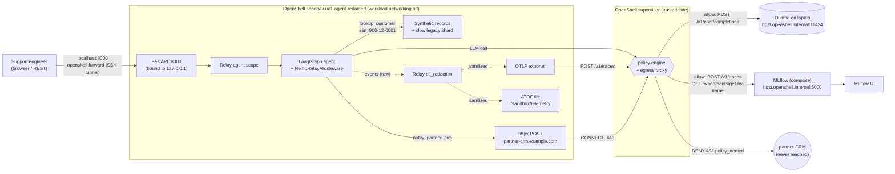

# Architecture

## Three layers of control

| Layer | Question it answers | Mechanism in this demo |
|---|---|---|
| **NeMo Relay** | What may the agent's *telemetry* contain? | `pii_redaction` sanitize guardrails on every lifecycle event, before any exporter |
| **OpenShell** | Where may the agent *process* connect, and what may it read or write? | Sandbox with networking off. Egress goes only through the supervisor, which enforces `openshell/policy.yaml` (L7 for HTTP). Landlock filesystem rules apply too. |
| **MLflow** | What happened, and why? | Traces with tool status, timing, and readable (sanitized) errors, including denied egress |

Relay protects the data in the evidence. OpenShell protects the data in
execution. Neither one replaces the other:

- With Relay alone, a buggy or prompt-injected tool can still send a customer
  record to an arbitrary host. Telemetry stays clean while the data leaves.
- With OpenShell alone, the SSN still lands in the trace store, because MLflow
  is an *allowed* destination.

## Components and data flow



## The sandbox boundary

OpenShell splits each sandbox into an untrusted **workload**, where the
agent runs, and a trusted **supervisor**:

- **Network.** The workload container runs with networking turned off. Its
  only way out is the mediated channel to the supervisor. The supervisor
  resolves DNS, checks each connection against the policy (binary + host +
  port, and for `protocol: rest` endpoints also method + path), and opens
  approved connections. Observed with OpenShell 0.1.9 on Podman:
  - A connection to a host that no rule allows is refused at TCP level. The
    client sees `ConnectError` (`EACCES`), and the sandbox log records
    `NET:OPEN [MED] DENIED /usr/local/bin/python3.12(0) -> partner-crm.example.com:443 [reason:transparent_tcp_policy_denied]`.
  - A request to an allowed host but a disallowed method or path gets an HTTP
    `403` with a JSON body, for example
    `{"error":"policy_denied","policy":"local_llm","rule":"POST /api/pull",…}`.
  - Allowed requests are logged as well, for example
    `HTTP:POST [INFO] ALLOWED POST http://host.openshell.internal:5000/v1/traces [policy:mlflow_tracking engine:l7]`.
- **Binary identity.** Rules name the executable that opens the connection.
  Scripts run as their interpreter, so the policy lists
  `/usr/local/bin/python3.12`, the real path in `python:3.12-slim`. Relay's
  exporter runs inside the same Python process, so it uses the same rule.
- **Filesystem.** Landlock restricts the workload to read-only system and
  application paths (`/usr`, `/lib`, `/etc`, `/app`, …) plus read-write
  `/sandbox` and `/tmp`. Relay writes its ATOF copy to `/sandbox/telemetry`
  and its rendered plugin config to `/tmp`.
- **Credentials.** With the optional NVIDIA provider, the workload's
  `NVIDIA_API_KEY` holds an opaque placeholder. The supervisor substitutes the
  real key only on requests to `integrate.api.nvidia.com`.
- **Inbound.** `openshell forward start 8000 <sandbox>` opens an SSH tunnel
  through the gateway to `127.0.0.1:8000` inside the sandbox. That is why
  uvicorn binds to loopback.

### Policy, rule by rule

| Rule | Endpoint | Allowed | Why |
|---|---|---|---|
| `mlflow_tracking` | `host.openshell.internal:5000` (REST, enforce) | `POST /v1/traces`, `GET /api/2.0/mlflow/experiments/get-by-name`, `POST /api/2.0/mlflow/experiments/create` | Export traces and resolve the experiment id. The agent cannot read other traces, download artifacts, or call admin APIs, even with valid credentials. |
| `local_llm` | `host.openshell.internal:11434` (REST, enforce) | `POST /v1/chat/completions`, `GET /v1/models` | The default LLM. Ollama's model management API (`/api/pull`, `/api/delete`, …) stays unreachable. |
| provider `uc1-nvidia-build` (optional) | `integrate.api.nvidia.com:443` | read-write | Hosted LLM, with endpoint-bound credential injection |
| *(everything else)* | | denied | Includes `partner-crm.example.com`, PyPI, and any other internet host |

The two layers enforce authorization independently. MLflow basic auth gives the
service account EDIT on two experiments only. The OpenShell L7 rules further
restrict *which MLflow APIs* the process can call at all.

## Trace structure in MLflow

```
customer-lookup-request            AGENT   demo.sandbox = uc1-agent-redacted
└── customer_lookup_agent          AGENT
    ├── model → <model>            LLM
    ├── tools → lookup_customer    TOOL    OK, ~200 ms   (or ERROR, ~2,000 ms timeout)
    ├── model → <model>            LLM
    ├── tools → notify_partner_crm TOOL    ERROR  "EgressBlocked: could not connect to partner-crm.example.com (ConnectError …). The record for SSN [REDACTED-SSN] was not sent."
    └── model → <model>            LLM
```

The blocked call is a normal tool failure from the agent's point of view.
`handle_tool_error = True` turns it into a `ToolMessage(status="error")`. The
agent explains it to the user, and Relay marks the span `ERROR`. This is the
bridge to UC2: the denial is visible evidence that the agent attempted a
prohibited action.

## Authentication and routing

This works as in `uc1-community`: MLflow basic auth, a least-privilege service
account, and routing by `x-mlflow-experiment-id` through Relay's
`header_env`. Two things differ:

- Relay's `insecure_http_hosts` allows `host.openshell.internal`, which is
  derived from `MLFLOW_TRACKING_URI`, instead of `mlflow`.
- MLflow's `--allowed-hosts` includes `host.openshell.internal`, because that
  is the `Host` header the sandboxed agent sends.

## Two sandboxes, one image, one policy

`uc1-agent-redacted` and `uc1-agent-baseline` use the same image and the same
`openshell/policy.yaml`. They differ only in `RELAY_PLUGINS_FILE`,
`MLFLOW_EXPERIMENT_NAME`, and the loopback port. The before/after comparison
still isolates the Relay policy as the only variable. It also shows that
OpenShell does **not** stop the SSN from reaching MLflow, because MLflow is
an allowed destination. Telemetry content is Relay's job.

## Alternative: OpenShell's agent trace relay

OpenShell 0.1.7 and later can relay OTLP from the sandbox to a collector that
is configured on the gateway (`[openshell.gateway.otlp.agent]`). In that mode
the sandbox gets `OTEL_EXPORTER_OTLP_ENDPOINT=http://192.0.0.8:4318`, needs no
egress rule, and the **MLflow credential lives in the gateway config instead
of the agent**. We did not use it here because headers are configured per
gateway. Both sandboxes would then write to one experiment, and the
redacted/baseline split would be lost. It is a strong option for the RHOAI
permutation. See OSH-5 in the [product gaps report](../../../docs/product-gaps.md#nvidia-openshell).
