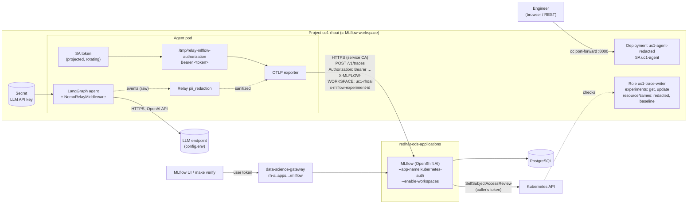

# Architecture

## Data flow



## How MLflow in OpenShift AI authenticates and routes

OpenShift AI runs MLflow with:

```
mlflow server --app-name=kubernetes-auth --enable-workspaces --workspace-store-uri=kubernetes:// \
  --static-prefix=/mlflow --port=8443 (TLS, OpenShift service CA)
MLFLOW_K8S_AUTH_AUTHORIZATION_MODE=self_subject_access_review
```

| Concern | How it works | What the demo does |
|---|---|---|
| Identity | Every request carries a Kubernetes bearer token. MLflow runs a **SelfSubjectAccessReview** with that token. | The agent sends its pod's **service account token**. |
| Workspace | `X-MLFLOW-WORKSPACE: <namespace>`. A workspace is a namespace. | `MLFLOW_WORKSPACE` = the project. Relay sends the header through `header_env`. |
| Authorization | RBAC on `experiments.mlflow.kubeflow.org` in that namespace. OTLP ingestion needs `update` on the experiment, resolved from `x-mlflow-experiment-id`. | Role `uc1-trace-writer`: `get`, `update` with `resourceNames` set to the two demo experiments |
| Experiment routing | `x-mlflow-experiment-id` | The agent resolves its experiment name to an id at startup. |
| Transport | HTTPS on `mlflow.redhat-ods-applications.svc:8443`, signed by the OpenShift service CA | The `uc1-service-ca` ConfigMap (CA bundle injected by OpenShift), used by Relay's `tls.certificate` and by the MLflow client |
| Paths | The REST API is under `/mlflow` (static prefix). **OTLP is at `/v1/traces`, without the prefix.** | `MLFLOW_TRACKING_URI=…:8443/mlflow`. The OTLP endpoint is derived as `…:8443/v1/traces`. |
| Browser and laptop access | The `data-science-gateway` route (`rh-ai.apps…/mlflow`) with OpenShift login. Unauthenticated requests are redirected. | The UI links and `make verify` go through it, using your user token. |

### Least privilege, validated live

| Agent service account | Result |
|---|---|
| Write traces to `uc1-rhoai-redacted` / `-baseline` | ✅ allowed |
| Write traces to `uc1-rhoai-not-granted`, in the same workspace | ❌ 403 |
| Create an experiment | ❌ 403. `make bootstrap` creates the experiments as the cluster user. |
| Read another experiment | ❌ 403 |

That is finer-grained than the per-experiment `EDIT` grant in uc1-community,
and it's plain Kubernetes RBAC: reviewable, GitOps-friendly, and with no
MLflow user database.

### Token rotation

OpenShift mounts a projected service account token that the kubelet rotates.
Relay's `header_file` sends a file's content **verbatim** as the header value,
and Relay re-reads it on every export, so the agent:

1. reads `/var/run/secrets/kubernetes.io/serviceaccount/token`,
2. writes `Bearer <token>` to `/tmp/relay-mlflow-authorization` (mode `0600`),
3. refreshes that file every 60 s from the rotating token.

The MLflow Python client only calls MLflow at startup (to resolve the
experiment), so it gets the token once, through `MLFLOW_TRACKING_TOKEN`.

## The redaction boundary

This works as in [uc1-community](../../uc1-community/docs/architecture.md#the-redaction-boundary).
Relay sanitizes each lifecycle event once, before any exporter. The OTLP
export to MLflow and the local ATOF file get the same sanitized stream. The
Relay policies are the community ones plus TLS, `header_file` and the
workspace header.

**Reasoning models.** GLM 5.3 returns a separate `reasoning_content` field.
LangChain's `ChatOpenAI` drops it, so traces contain only reasoning *token
counts*, never the reasoning text. If a future integration captures that text,
it is a string leaf, and the regex profile would redact SSNs in it.

## Keeping the SSN from the LLM (opt-in)

Telemetry redaction leaves execution alone, so the LLM still receives the SSN.
A chat request with `"protect_llm": true` (the *Keep SSN from the LLM*
checkbox) registers two Relay request intercepts on that request's scope
([`llm_protection.py`](../agent/src/customer_lookup_agent/llm_protection.py)):
one replaces each SSN in the LLM request with a reference such as `SSN_REF_1`,
the other swaps the real SSN back into the tool's arguments. The LLM span in
MLflow records the reference the model received.
[uc1-community](../../uc1-community/docs/architecture.md#keeping-the-ssn-from-the-llm-opt-in)
shows the sequence.

## Two agents, one image

`uc1-agent-redacted` and `uc1-agent-baseline` share the image, the service
account and the Role. They differ only in `RELAY_PLUGINS_FILE` and
`MLFLOW_EXPERIMENT_NAME`. The image is built in-cluster by a BuildConfig from
your local checkout (`make build`), so no external registry is involved.
