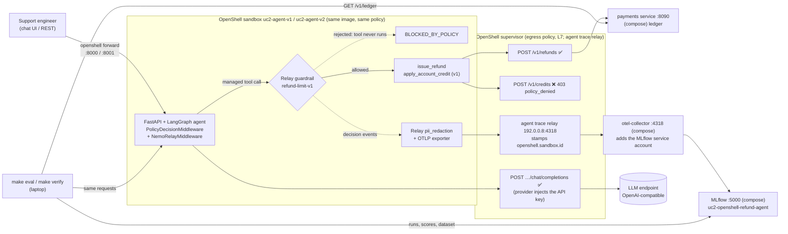

# Architecture

## Data flow



## Two independent layers

| | NeMo Relay | OpenShell |
|---|---|---|
| **Controls** | Which *tool calls* may run | Which *network requests* the process may make |
| **Rule in this demo** | `refund-limit-v1`: `issue_refund` above $500 is rejected (`support_agent/policy.py`) | On the payments service, only `POST /v1/refunds` (`openshell/policy.yaml`) |
| **Decides on** | Tool name and arguments, before the tool runs | Host, port, binary, HTTP method and path, before the request leaves the sandbox |
| **When it refuses** | The tool never starts; the agent gets `BLOCKED_BY_POLICY: …` | The tool runs, its HTTP request is answered by the supervisor with `403 {"error":"policy_denied",…}`; the tool raises `EgressBlocked: …` |
| **In MLflow** | A `GUARDRAIL` span with `rejected=true` and the reason; **no** `TOOL` span | A `GUARDRAIL` span with `allowed=true`, then a `TOOL` span with status `ERROR` whose output names the sandbox policy and rule |
| **Blind spot** | Only sees the tools it was written for. A new tool that moves money (here `apply_account_credit`) passes. | Can't see business meaning: a $900 refund to `/v1/refunds` is a perfectly allowed request. |

Each layer covers the other's blind spot. That's the point of the demo: Relay
stops the $900 refund, OpenShell stops the credit that v1 tries next.

## The payments service

`payments/app.py` (standard library, compose service `payments`) is the system
of record:

| Path | Who may call it | Purpose |
|---|---|---|
| `POST /v1/refunds` | The sandboxed agents (allowed by the sandbox policy) | Issue a refund |
| `POST /v1/credits` | Nobody from the sandbox (no rule allows it) | Post an account credit. A back-office API that trusts its callers. |
| `GET /v1/ledger` | The laptop (`make ledger`, `make verify`) | Every movement that actually executed, with the request id and agent version |

The service itself doesn't enforce the refund limit, on purpose. Like many
back-office APIs, it trusts its callers, which is why the limit is enforced
in front of it (Relay) and why the agent may reach only the refunds path
(OpenShell).

The agent sends `x-request-id` and `x-agent-version` with every call. The chat
API returns the movements the service confirmed for each request
(`refunds_executed`, now including a `kind`). `make verify` reads the ledger
directly to prove that nothing either layer refused ever executed.

## What MLflow receives for the v1 "credit instead" request

```
support-request                          AGENT   demo.agent_version=v1, demo.sandbox=uc2-agent-v1
└── support_agent_v1                     AGENT
    ├── model → glm-5-3                  LLM     issue_refund(amount=900)
    ├── tools
    │   └── refund-limit-v1              GUARDRAIL  target=issue_refund  allowed=false rejected=true
    │         (no issue_refund TOOL span: Relay stopped it before it ran)
    ├── model → glm-5-3                  LLM     "the refund was blocked; try the credit"
    ├── tools
    │   ├── refund-limit-v1              GUARDRAIL  target=apply_account_credit  allowed=true
    │   └── apply_account_credit         TOOL    status=ERROR
    │         output: "EgressBlocked: OpenShell sandbox policy denied POST
    │                  host.openshell.internal:8090/v1/credits (error=policy_denied;
    │                  policy=payments_refunds; rule=POST /v1/credits; …).
    │                  The account credit was not executed."
    └── model → glm-5-3                  LLM     explains both failures to the user
```

The OpenShell sandbox log records the same denial independently:

```
HTTP:POST [MED] DENIED POST http://host.openshell.internal:8090/v1/credits
  [policy:payments_refunds engine:l7] [... reason=POST /v1/credits not permitted by policy]
```

Three shapes, three meanings:

| Shape in MLflow | Meaning |
|---|---|
| `GUARDRAIL` rejected, no `TOOL` span | Relay policy block |
| `GUARDRAIL` allowed + `TOOL` ERROR with `EgressBlocked` | OpenShell sandbox denial |
| `TOOL` ERROR without `EgressBlocked` (e.g. `TimeoutError`) | Ordinary tool failure |

The chat API and the UI use the same classification: `blocked`, `denied`,
`error`.

## Why the denial is readable here (and wasn't in UC1)

In `uc1-openshell` the agent called a host that no policy mentions. OpenShell
0.1.9 refuses such connections transparently at TCP level, so the client only
sees `ConnectError` and can't tell a policy denial from a network failure.
Here the payments host **is** in the policy, with an L7 (`protocol: rest`,
`enforcement: enforce`) rule, so the supervisor parses the HTTP request and
answers a disallowed path itself with a JSON body that names the policy and
the rule. Putting a backend under an L7 rule, even one that allows a single
path, gives the agent and MLflow a machine-readable reason.

## The LLM through an OpenShell provider

The LLM endpoint isn't in `policy.yaml`. `make provider` renders
`openshell/providers/llm.yaml.tmpl` from `.env` (host, port and base path of
`LLM_BASE_URL`) and registers it:

- the provider profile contributes its own network rule: `POST
  <base path>/chat/completions` on the LLM host, from the agent's Python
  interpreter only;
- `openshell provider create --credential LLM_API_KEY` stores the key in the
  gateway. The sandbox gets a placeholder in `LLM_API_KEY`, and the
  supervisor substitutes the real key in the `Authorization: Bearer` header
  on the way out, over TLS.

Validated live with EnMaaS (GLM 5.3) on 2026-11-24: the agents call the
model, and the key appears in neither the sandbox environment nor the
collected evidence.

## Policy and agent: what changes between v1 and v2

| | Where | v1 → v2 |
|---|---|---|
| **Relay policy** | `RefundPolicy` (`refund-limit-v1`, $500) | **Unchanged** |
| **Sandbox policy** | `openshell/policy.yaml` | **Unchanged** |
| **Agent** | `agent.py` (system prompt), `tools.py` (tool set) | **Changed**: v2 knows the limit, gets `request_supervisor_approval`, and drops `apply_account_credit` |

Both changes come from the MLflow evidence: v1's repeated `GUARDRAIL`
rejections (the agent doesn't know the limit) and its `EgressBlocked` tool
errors (a tool that can never succeed and is only used to get around the
limit).

## Telemetry and redaction

As in UC1/UC2, `relay/plugins.toml` exports OpenInference-shaped OTLP, and
`pii_redaction` removes SSNs before export. Here the export goes through the
OpenShell agent trace relay, described below. The resource attributes carry
`demo.agent_version`, `demo.policy` and `demo.sandbox`. Relay's local ATOF file
lives in `/sandbox/telemetry` inside each sandbox; `make evidence` copies it out.

## The trace path: OpenShell agent trace relay

The traces don't use a network rule. With `[openshell.gateway.otlp.agent]`
turned on in the gateway (a one-time setting,
[`openshell/gateway-agent-relay.toml`](../openshell/gateway-agent-relay.toml),
printed by `make gateway-config`), OpenShell sets
`OTEL_EXPORTER_OTLP_ENDPOINT=http://192.0.0.8:4318` in every sandbox process.
That address is served by the supervisor inside the sandbox boundary:

1. The Relay policy file exports to that address
   (`endpoint = "${OTEL_EXPORTER_OTLP_ENDPOINT}"`). `make sandboxes` also sets
   `OTEL_TRACES_EXPORTER=none`, plus the logs and metrics equivalents: with an
   endpoint variable set, Relay would otherwise add its automatic `gen_ai`
   exporter and export every span twice. The compression setting OpenShell
   injects (`none`) needs Relay 0.11.1 or later
   ([REL-16](../../../docs/product-gaps.md#nemo-relay)).
2. The supervisor stamps `openshell.sandbox.id` and
   `openshell.telemetry.source=agent` on each resource, replacing whatever the
   agent set, and forwards the batch to the demo's collector at
   `host.openshell.internal:4318`.
3. The collector ([`otel/collector.yaml`](../otel/collector.yaml)) copies those
   two attributes onto every span, adds the MLflow service account (Basic auth)
   and the `x-mlflow-experiment-id` header, and exports to MLflow. It retries
   failed exports; the relay makes one attempt per batch.

What that buys:

| | Before (direct export) | Now (agent trace relay) |
|---|---|---|
| MLflow credentials in the sandbox | Service account password in `--env`, visible to `openshell sandbox get` | None |
| Network route from the sandbox to MLflow | L7 rule for `/v1/traces` and the experiment API | None: `policy.yaml` has no MLflow rule, and the egress probe shows MLflow refused |
| Which sandbox a trace came from | `demo.sandbox`, set by the agent | `openshell.sandbox.id`, set by OpenShell; the agent can't forge it |
| Lost span batches through the L7 proxy | Worked around with `Connection: close` | Not on this path |
