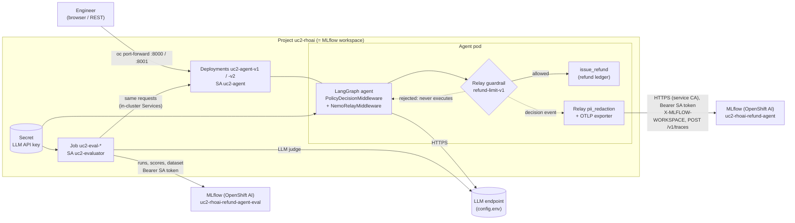

# Architecture

## Data flow



## The policy lives in Relay; the agent changes

| | Where | v1 → v2 |
|---|---|---|
| **Policy** | `RefundPolicy`, registered with `nemo_relay.guardrails.register_tool_conditional_execution("refund-limit-v1", …)` | **Unchanged** |
| **Agent** | System prompt + tool definitions in `agent.py` / `tools.py` | **Changed**: v2 knows the limit and gets `request_supervisor_approval` |

Relay runs conditional-execution guardrails **before** the tool callback.
Returning a reason blocks the call. Returning `None` allows it.

```python
class RefundPolicy:
    def __call__(self, tool_name, args):
        if tool_name == "issue_refund" and float(args["amount"]) > self.limit:
            return f"{self.name}: refund of ${amount:,.2f} exceeds the ${limit:,.2f} limit ..."
        return None
```

Relay 0.11 has no config-file component for custom conditional-execution
guardrails (only `pii_redaction` and the deprecated NeMo Guardrails
component). So the policy is registered in code, and its version is part of
its name.

## From rejection to agent behavior

Relay signals a rejection by raising `RuntimeError("guardrail rejected: …")`
out of the managed tool call. Unhandled, that aborts the whole LangGraph run:
the user gets an error and the agent can't adapt. `PolicyDecisionMiddleware`
turns it into an ordinary tool result:

```
ToolMessage(status="error",
            content="BLOCKED_BY_POLICY: refund-limit-v1: refund of $900.00 exceeds ... The action was not executed.")
```

**Middleware order matters.** LangChain composes middleware first-defined =
outermost: `[PolicyDecisionMiddleware(), NemoRelayMiddleware()]`. Relay
records the decision first, and the policy middleware then converts the
exception on the way out.

## What MLflow receives

For a blocked refund:

```
support-request                       AGENT   demo.agent_version = v1, demo.policy = refund-limit-v1  (workspace uc2-rhoai)
└── support_agent_v1                  AGENT
    ├── model → <llm>                 LLM     decides to call issue_refund(amount=900)
    ├── tools                         AGENT   input: [{"name": "issue_refund", "args": {"amount": 900, ...}}]
    │   └── refund-limit-v1           GUARDRAIL
    │         start: kind=tool_conditional_execution, target_name=issue_refund
    │         end:   allowed=false, rejected=true, rejection_reason="refund-limit-v1: refund of $900.00 exceeds ..."
    │         (no issue_refund TOOL span: the tool never started)
    └── model → <llm>                 LLM     explains the block to the user
```

For an allowed refund, the `GUARDRAIL` span has `allowed=true` and an
`issue_refund` `TOOL` span follows. For a tool failure (lookup timeout) there
is a `TOOL` span with status `ERROR` and no rejection. That's how policy
rejections and tool failures stay distinguishable.

The **refund ledger** (`refunds.py`) is independent evidence. Every executed
refund is recorded with the id of the request that made it, and the chat API
returns `refunds_executed` per request. Evaluation and tests use it to prove
blocked refunds never ran. Requests are tagged with a context variable,
because the server handles requests concurrently, for example during
evaluation.

## Telemetry, identity and redaction on OpenShift AI

This is the same wiring as [uc1-rhoai](../../uc1-rhoai/docs/architecture.md):
- Relay exports OTLP over TLS to `https://mlflow.redhat-ods-applications.svc:8443/v1/traces`. The OTLP route is not under the `/mlflow` prefix.
- It trusts the injected OpenShift service CA.
- It authenticates with the pod's **service account token**, sent as `Bearer`, from a refreshed header file.
- It routes with `X-MLFLOW-WORKSPACE: uc2-rhoai` and `x-mlflow-experiment-id`.
- `pii_redaction` removes SSNs before export.

| Identity | Role | Allowed |
|---|---|---|
| `uc2-agent` (both agent versions) | `uc2-trace-writer` | `get`, `update` on experiment `uc2-rhoai-refund-agent` only (`resourceNames`) |
| `uc2-evaluator` (the evaluation Job) | `uc2-evaluator` | `get`, `update` on experiments in the project, plus `get`, `list`, `create`, `update` on datasets. It isn't name-scoped because of an auth-plugin bug with artifact paths ([product-gaps](product-gaps.md)). |
| you (`make bootstrap`, `make verify`) | project admin | Create the experiments; read everything back |

## Two agents, one image, one policy

`uc2-agent-v1` and `uc2-agent-v2` are the same image and the same Relay policy. They
differ only in `AGENT_VERSION`, which selects the system prompt and the tool
definitions.
The same image also runs the evaluation Job, because it includes the `eval` extra.
