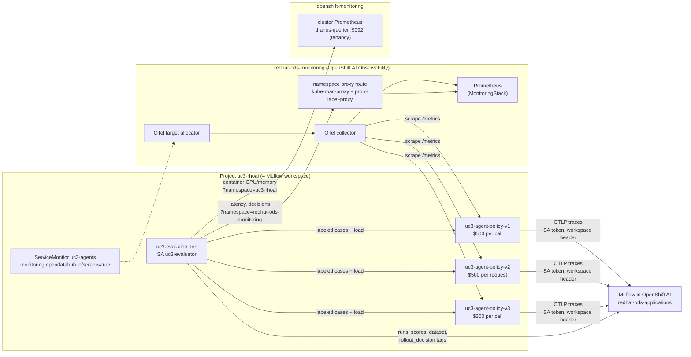

# Architecture

## Data flow



## Workloads and identities

| Object | Identity | Can do |
|---|---|---|
| `uc3-agent-policy-v1/v2/v3` (Deployments) | SA `uc3-agent` | `get`, `update` on the trace experiment only (Role `uc3-trace-writer`) |
| `uc3-eval-<id>` (Job) | SA `uc3-evaluator` | Experiments and datasets in the workspace (`uc3-evaluator`); `get pods`, `get pods.metrics.k8s.io` in `uc3-rhoai` (`uc3-metrics-reader`); `get pods.metrics.k8s.io` in `redhat-ods-monitoring` (`uc3-rhoai-metrics-reader`, see below) |
| `make verify` (laptop) | You (`oc whoami -t`) | Reads MLflow, both metrics endpoints, and a short-lived agent token for the least-privilege check |

All three Deployments use the same image and the same agent (`AGENT_VERSION=v1`).
Only `POLICY_VERSION` differs. The policies, the per-request budget and the
trace shapes are described in
[`uc3-community/docs/architecture.md`](../../uc3-community/docs/architecture.md).

## Latency and resources from OpenShift AI Observability

**The agents' own metrics** (`uc3_chat_request_seconds`,
`uc3_guardrail_eval_seconds`, `uc3_guardrail_decisions_total`):

1. The `ServiceMonitor uc3-agents` carries the label
   `monitoring.opendatahub.io/scrape: "true"`. The RHOAI collector's target
   allocator selects such monitors in **every** namespace.
2. The collector scrapes `/metrics` on the three Services, adds Kubernetes
   resource attributes (`k8s_namespace_name`, `k8s_pod_name`, …) and re-exports
   the series. The stack's Prometheus scrapes that re-export.
3. **The relabeling gap:** that last scrape doesn't honor labels, so
   `namespace` becomes `redhat-ods-monitoring` and the project is kept in
   `exported_namespace` and `k8s_namespace_name`. The namespace proxy only
   serves `?namespace=redhat-ods-monitoring` for these series.
4. So the evaluation queries the proxy route with
   `namespace=redhat-ods-monitoring` and selects
   `policy="vN",k8s_namespace_name="uc3-rhoai"`. That needs
   `get pods.metrics.k8s.io` in `redhat-ods-monitoring`
   (`openshift/monitoring-access.yaml`, applied by `make monitoring-access`).
   The grant isn't tenant-scoped: OBS-2 in the [product gaps report](../../../docs/product-gaps.md).

**Container CPU and memory:** the RHOAI stack doesn't collect them. The
evaluation queries the cluster Prometheus through `thanos-querier`'s tenancy
port (`:9092`, `?namespace=uc3-rhoai`, authorized by `get pods` in the
project):

```
sum(increase(container_cpu_usage_seconds_total{namespace="uc3-rhoai",pod=~"uc3-agent-policy-v2-.*",container="agent"}[W]))
max(max_over_time(container_memory_working_set_bytes{namespace="uc3-rhoai",pod=~"uc3-agent-policy-v2-.*",container="agent"}[W]))
```

The RHOAI dashboards' "Cluster Prometheus" Perses datasource uses the same
source.

**Timing:** there are two 30-second scrape hops (agent → collector →
Prometheus), so the Job waits 70 s after each policy's load before querying,
and windows are at least 2 minutes.

## The evaluation Job

`make eval` creates `uc3-eval-<timestamp>` from `openshift/eval-job.yaml`. It
runs the same `evaluation.py` as `uc3-community` against the in-cluster
Services, one policy at a time. It logs one MLflow run per policy (the rates,
the RHOAI and cluster metrics, and the rollout tags). The judge's API key comes
from the same Secret as the agents', so it never leaves the cluster.

## MLflow in OpenShift AI

As in `uc2-rhoai`:
- the agents export OTLP with their rotating service account token (Relay
  `header_file`) and the `X-MLFLOW-WORKSPACE` header;
- the Job authenticates with its own token;
- the trace experiment is named in the agents' Role, so they can't write
  anywhere else (`make verify` checks this with a 403).
